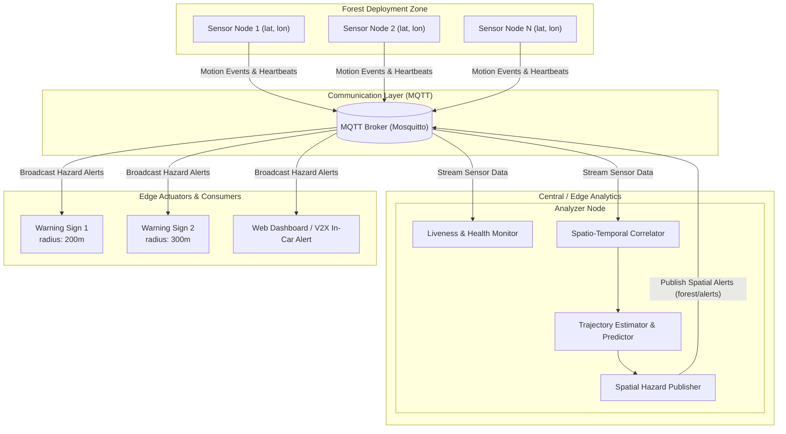
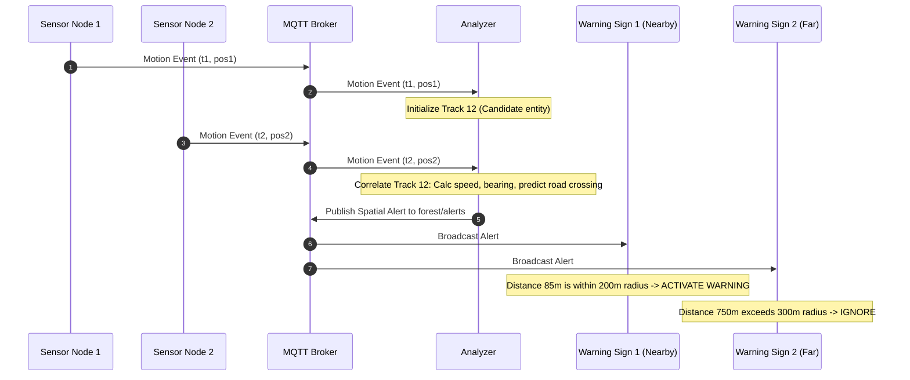

# System Architecture: IoT Wildlife Mesh & Road Safety Warning System

## 1. System Overview & Objective

This project implements an IoT-based spatial tracking and early-warning system designed to prevent wildlife-vehicle collisions.

A distributed array of low-power sensor nodes is deployed across a forested area. When wildlife moves through the sensor field, sequential sensor activations are streamed over MQTT to an **Analyzer Node**. 

The Analyzer aggregates spatio-temporal data to track the animal's path, calculates its speed and heading vector, and predicts where and when it will intersect a nearby roadway. Rather than tightly coupling the Analyzer to individual signs, the Analyzer publishes **Spatial Hazard Alerts** containing the projected crossing coordinates. **Warning Sign Nodes** along the road (and any other interested subscribers) act as autonomous edge consumers: each sign monitors alerts and activates dynamically if the hazard falls within its locally configured safety radius.

---

## 2. High-Level System Architecture



---

## 3. Node Types & Responsibilities

### 3.1 Sensor Nodes (Detectors)
Battery- or solar-powered devices deployed throughout the forest.
- **Hardware-Agnostic Sensing**: Can represent PIR (passive infrared), ultrasonic, radar, micro-lidar, or break-beam tripwires.
- **Static Geolocation**: Configured at deployment with precise geographical coordinates (latitude, longitude, elevation/zone ID).
- **Periodic Heartbeat**: Emits low-frequency status pings to verify operational integrity, battery status, and signal strength.
- **Event-Driven Motion Publishing**: Emits an immediate event whenever movement is detected within its detection radius.
- **Debouncing & Cooldown**: Implements a brief local cooldown period to prevent flooding the network on sustained local movement.

### 3.2 Analyzer Node (Core Intelligence)
A centralized or edge compute unit that ingests sensor streams and runs spatial correlation logic.
- **Sensor Registry & Health Monitor**: Maintains an in-memory spatial map of deployed sensors; tracks heartbeats and Last Will and Testament (LWT) statuses to flag missing or malfunctioning nodes.
- **Spatio-Temporal Correlation**: Correlates separate motion events across space and time windows:
  - Distinguishes isolated noise (e.g., wind-blown branches) from moving entities.
  - Groups sequential sensor hits into track hypotheses (Track IDs).
- **Trajectory Estimation & Prediction**:
  - Calculates movement vector: direction (bearing), ground speed, and variance.
  - Projects path forward across a lookahead time horizon (e.g., next 15–60 seconds).
  - Determines the estimated roadway intersection coordinate and Time-to-Arrival (TTA).
- **Spatial Hazard Publisher**:
  - Broadcasts spatial hazard alerts containing coordinates, estimated arrival time, and confidence onto regional/global alert topics.
  - **Decoupled Architecture**: The Analyzer does not need to know the number, IDs, or locations of warning signs.

### 3.3 Warning Sign Nodes (Autonomous Spatial Consumers)
Physical or simulated road signs positioned along roadways.
- **Static Geolocation & Configurable Zone**: Configured with its own GPS coordinates `(lat, lon)` and a custom safety radius (e.g., 200m for straight roads, 350m before blind curves).
- **Spatial Geofencing Filter**: Subscribes to the broadcast alert stream (`forest/alerts` or sector topic). Upon receiving an alert, computes the distance to the projected hazard point:
  $$\text{dist}(P_{\text{sign}}, P_{\text{hazard}}) \le R_{\text{configured}}$$
  Activates warnings only if the event falls within its configured coverage zone.
- **Visual / Audio Actuation**: Triggers physical signaling (e.g., flashing amber LEDs, dynamic speed advisory).
- **Fail-Safe Timeout**: Incorporates a hardware/local watchdog countdown timer. The sign automatically deactivates after the designated duration expires, preventing signs from getting stuck ON if connection is lost.

---

## 4. MQTT Architecture & Topic Hierarchy

A clean, hierarchical topic design enables wildcard subscriptions, granular filtering, and separation of concerns.

### 4.1 Topic Structure

| Channel | Topic Pattern | QoS | Retained | Purpose |
|---|---|---|---|---|
| **Sensor Heartbeat** | `forest/sensors/{sensor_id}/heartbeat` | 0 | No | Periodic liveness & battery telemetry |
| **Sensor Status (LWT)** | `forest/sensors/{sensor_id}/status` | 1 | Yes | Online/Offline status via Last Will & Testament |
| **Motion Event** | `forest/sensors/{sensor_id}/motion` | 1 | No | Triggered instantly upon detection |
| **Spatial Hazard Alert** | `forest/alerts` or `forest/alerts/{sector_id}` | 1 | No | Broadcast hazard warning with coordinates |
| **Warning Sign Status (LWT)** | `forest/warning_signs/{sign_id}/status` | 1 | Yes | Sign operational & health status |
| **System Broadcast** | `forest/system/broadcast` | 1 | No | Global config, synchronizations, or resets |

### 4.2 Quality of Service (QoS) & Reliability Policies
- **QoS 0 for Heartbeats**: Dropping an occasional periodic heartbeat is acceptable; subsequent heartbeats will maintain liveness state.
- **QoS 1 for Motion Events & Spatial Alerts**: Motion detections and hazard alerts require guaranteed delivery (at least once) due to safety implications.
- **Retained LWT (Last Will and Testament)**:
  - During connection, all nodes set LWT on their respective `.../status` topic with payload `{"state": "offline"}`.
  - Upon clean connection, nodes publish `{"state": "online"}` with Retain = `true`.
  - Enables the system to detect node drops instantly without waiting for heartbeat timeouts.
- **Multi-Consumer Extensibility**: Because alerts are spatial broadcasts rather than directed commands, additional consumers (such as ranger vehicle tablets, web mapping dashboards, or connected car V2X receivers) can subscribe to `forest/alerts/#` without modifying the Analyzer.

---

## 5. Conceptual Data Payloads

*(Format: JSON schemas for interoperability and simulation)*

### 5.1 Sensor Heartbeat
```json
{
  "sensor_id": "sensor_north_042",
  "timestamp": 1794501230,
  "battery_pct": 94,
  "location": {
    "latitude": 47.3769,
    "longitude": 8.5417
  }
}
```

### 5.2 Motion Event
```json
{
  "event_id": "evt_983247",
  "sensor_id": "sensor_north_042",
  "timestamp": 1794501245.32,
  "location": {
    "latitude": 47.3769,
    "longitude": 8.5417
  },
  "confidence": 0.95
}
```

### 5.3 Spatial Hazard Alert (Decoupled Broadcast)
```json
{
  "alert_id": "alt_00384",
  "track_id": "track_12",
  "timestamp": 1794501246.10,
  "hazard_type": "WILDLIFE_CROSSING",
  "projected_crossing": {
    "latitude": 47.3781,
    "longitude": 8.5430
  },
  "bearing_deg": 42.5,
  "speed_mps": 3.8,
  "time_to_crossing_sec": 18.5,
  "confidence": 0.91,
  "recommended_duration_sec": 30
}
```

---

## 6. Motion Tracking & Spatial Alert Sequence



### 6.1 Multi-Point Spatio-Temporal Association
1. **Spatial Radius Threshold ($R_{max}$)**: When a motion event arrives at $(x_2, y_2, t_2)$, the Analyzer queries recent events within distance $R_{max}$.
2. **Velocity Gating ($V_{min} \le V \le V_{max}$)**: Candidate predecessor points must satisfy realistic animal movement speeds:
   $$\frac{\text{Distance}(P_1, P_2)}{t_2 - t_1} \in [V_{min}, V_{max}]$$
   Events faster than maximum sprint speed or impossibly slow are rejected as unrelated or concurrent entities.
3. **Track Formation**: Sequential matching points form a trajectory history $T = [P_1, P_2, \dots, P_k]$.

### 6.2 Trajectory Extrapolation & Roadway Intersection
- **Vector Extrapolation**: Linear projection or Kalman filtering computes the projected heading angle $\theta$ and current speed $v$.
- **Projected Uncertainty Cone**: Forward projection fans out into an uncertainty cone to account for potential direction changes.
- **Road Intersection Point**: The intersection of the vector cone with the road line geometry yields the target crossing coordinate $P_{\text{crossing}}$ and estimated Time-to-Arrival (TTA).

### 6.3 Edge Geofence Evaluation on Signs
When a warning sign receives an alert:
1. Calculates ground distance $d = \text{distance}(P_{\text{sign}}, P_{\text{crossing}})$ using the Haversine formula or local flat-earth approximation.
2. If $d \le R_{\text{sign\_radius}}$, the sign activates its alert indicators and initializes a countdown timer based on `recommended_duration_sec`.
3. If $d > R_{\text{sign\_radius}}$, the event is discarded locally.

---

## 7. Reliability, Edge Cases & Fault Tolerance

| Scenario | Potential Impact | Architectural Mitigation |
|---|---|---|
| **Adding / Moving Signs** | Configuration drift | **Zero-touch**: No changes required on the Analyzer. Signs only need their own coordinates and radius set locally. |
| **Sensor Battery Depletion / Physical Damage** | Blind spots in mesh | Analyzer health-check marks node as inactive on missed heartbeat or LWT; alerts system administrator. |
| **False Positives (Wind, Leaves, Small Birds)** | False alarms at roadside | Analyzer requires multi-sensor spatial confirmation before broadcasting road alerts (single isolated triggers create candidate tracks but do not publish hazard alerts). |
| **Network Interruption / Broker Disconnect** | Warning signs stuck in alert state | Warning signs run a local auto-reset timer; signs clear themselves if no refresh arrives within `recommended_duration_sec`. |
| **Multiple Animals Moving Concurrently** | Crossed or confused tracks | Tracker supports multiple concurrent Track IDs via spatial distance clustering (nearest-neighbor or Hungarian algorithm). |
| **Varying Road Topography (Curves vs Straights)** | Under- or over-warning drivers | Each warning sign configures its own warning radius independently (e.g., 350m for sharp blind bends, 150m for straight sections). |

---

## 8. Development & Simulation Strategy

To facilitate university testing and evaluation without immediate physical deployment:

1. **Virtual Sensor Simulator**: A script capable of simulating synthetic forest nodes, sending realistic heartbeats, and playing scripted or randomized "animal walk" paths triggering sensors sequentially.
2. **Virtual Warning Sign Simulator / CLI**: Independent client processes running at different coordinates, proving that nearby signs trigger while distant signs ignore the same broadcast alert.
3. **Map / Topology Visualizer**: An ASCII, 2D canvas, or lightweight UI plotting sensor positions, active detections, computed vectors, and warning sign states in real time.
