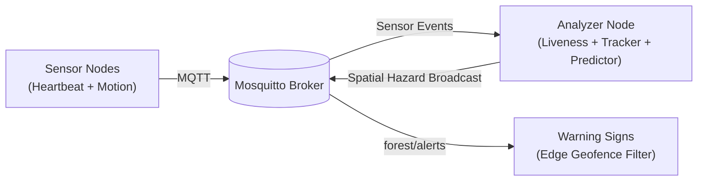
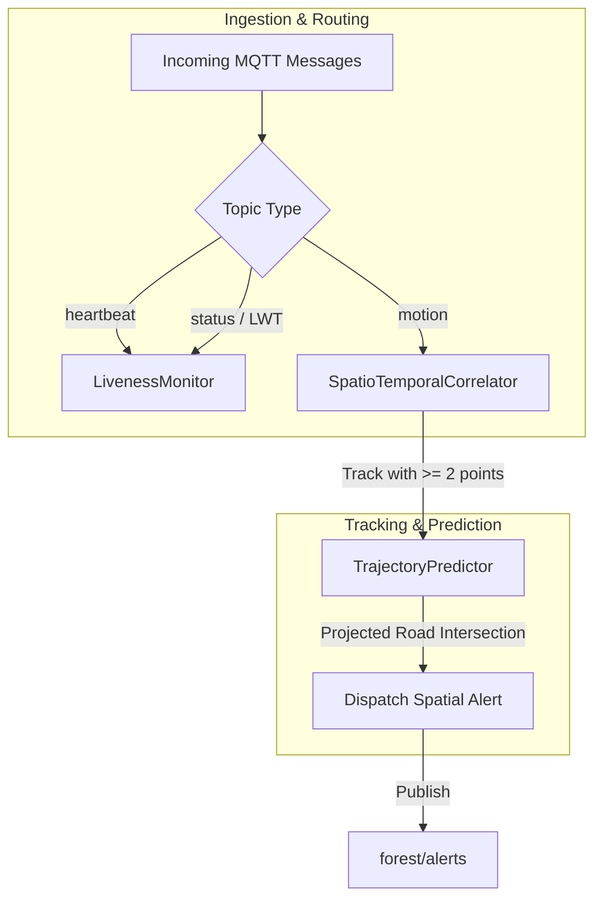

# Implementation Plan: IoT Wildlife Mesh & Road Safety Warning System

This guide outlines a step-by-step roadmap to build the system from scratch. Each phase introduces one layer of the architecture, explaining the conceptual goal, key classes, methods to implement, and how to verify that step before proceeding.

---

## High-Level Architecture Recap



---

## Phase 1: Shared Models, Geospatial Math & MQTT Foundation

### Step 1.1: Environment Configuration (`common/config.py`)
* **Goal**: Provide centralized broker constants and standardized MQTT topic strings.
* **Key Tasks**:
  - Load environment variables using `python-dotenv`.
  - Create a `Topics` class with helper functions producing standard topic strings:
    - Sensor heartbeats: `forest/sensors/{id}/heartbeat`
    - Sensor LWT/status: `forest/sensors/{id}/status`
    - Sensor motion events: `forest/sensors/{id}/motion`
    - Broadcast alerts: `forest/alerts`
    - Warning sign status: `forest/warning_signs/{id}/status`

### Step 1.2: Data Contracts (`common/models.py`)
* **Goal**: Define clean, serializable data transfer objects (DTOs) for network payloads.
* **Classes to Implement**:
  - `GeoPoint`: Dataclass holding `latitude: float`, `longitude: float`, and optional `elevation_m`.
  - `SensorHeartbeat`: Dataclass holding `sensor_id`, `location: GeoPoint`, `battery_pct: float`, `timestamp: float`. Provide `.to_json()` and `.from_dict()`.
  - `MotionEvent`: Dataclass holding `event_id`, `sensor_id`, `location: GeoPoint`, `timestamp: float`, `confidence: float`. Provide `.to_json()` and `.from_dict()`.
  - `SpatialHazardAlert`: Dataclass holding `alert_id`, `track_id`, `timestamp`, `hazard_type`, `projected_crossing: GeoPoint`, `bearing_deg: float`, `speed_mps: float`, `time_to_crossing_sec: float`, `confidence: float`, `recommended_duration_sec: float`.

### Step 1.3: Geospatial Math (`common/geo.py`)
* **Goal**: Pure mathematical functions for spherical distance, heading, and projection without heavy external GIS libraries.
* **Functions to Implement**:
  - `haversine_distance(p1: GeoPoint, p2: GeoPoint) -> float`: Computes great-circle distance in meters between two coordinates.
  - `calculate_bearing(p1: GeoPoint, p2: GeoPoint) -> float`: Computes initial compass heading in degrees $[0^\circ, 360^\circ)$ from point 1 to point 2.
  - `project_point(origin: GeoPoint, bearing_deg: float, distance_meters: float) -> GeoPoint`: Given a start point, bearing, and distance, calculates the destination coordinates.
* **Verification**: Write a small unit test verifying that two coordinates with known distance (e.g. 100 meters apart) calculate accurately within a 1% margin.

### Step 1.4: Base MQTT Client Wrapper (`common/mqtt_base.py`)
* **Goal**: Abstract away Paho MQTT boilerplate, callback handling, and Last Will and Testament (LWT).
* **Class to Implement: `BaseMQTTNode`**:
  - `__init__(client_id, lwt_topic, lwt_payload)`: Initializes `paho.mqtt.client.Client(CallbackAPIVersion.VERSION2)`. Configures LWT with `qos=1, retain=True`.
  - `connect(host, port, keepalive)`: Connects to the broker and calls `client.loop_start()`.
  - `disconnect()`: Stops loop and disconnects cleanly.
  - `publish_json(topic, payload, qos, retain)`: Serializes dictionaries/strings and publishes.
  - `subscribe(topic, qos)`: Subscribes to MQTT topics.
  - Callback hooks for child classes to override: `on_connected()`, `on_disconnected()`, `on_message_received(topic, payload)`.
* **Verification**: Connect a dummy node, verify `on_connected` fires, publish a test payload, and confirm disconnection without errors.

---

## Phase 2: Building the Edge Nodes

### Step 2.1: Sensor Node (`nodes/sensor.py`)
* **Goal**: Simulate an in-forest detector sending periodic heartbeats and event-driven motion triggers.
* **Class to Implement: `SensorNode(BaseMQTTNode)`**:
  - Attributes: `sensor_id`, `location: GeoPoint`, `heartbeat_interval_sec`, `battery_pct`.
  - Set LWT topic to `forest/sensors/{id}/status` with `{"state": "offline"}`.
  - `on_connected()`: Publishes `{"state": "online"}` with `retain=True` and launches a background daemon thread that calls `publish_heartbeat()` periodically.
  - `publish_heartbeat()`: Publishes a `SensorHeartbeat` object to `forest/sensors/{id}/heartbeat` (QoS 0).
  - `trigger_motion(confidence=1.0)`: Instantly constructs a `MotionEvent` with current timestamp and publishes to `forest/sensors/{id}/motion` (QoS 1).
  - CLI `main()`: Use `argparse` (`--id`, `--lat`, `--lon`, `--interval`). Wait for terminal `<Enter>` keypresses to trigger motion interactively.
* **Verification**: Run `uv run mesh-sensor --id s1 --lat 47.376 --lon 8.541`. Use `mosquitto_sub -t 'forest/#' -v` to observe heartbeats every $N$ seconds, then press `<Enter>` and observe the motion event payload.

### Step 2.2: Autonomous Warning Sign Node (`nodes/warning_sign.py`)
* **Goal**: Roadside actuator that subscribes to all hazard alerts and filters them via local edge geofencing.
* **Class to Implement: `WarningSignNode(BaseMQTTNode)`**:
  - Attributes: `sign_id`, `location: GeoPoint`, `warning_radius_meters`, `is_active: bool`.
  - Set LWT topic to `forest/warning_signs/{id}/status`.
  - `on_connected()`: Subscribes to `forest/alerts`.
  - `on_message_received(topic, payload)`: Deserializes `SpatialHazardAlert`.
  - Geofence Evaluation:
    $$d = \text{haversine\_distance}(\text{self.location}, \text{alert.projected\_crossing})$$
    - If $d \le \text{warning\_radius\_meters}$: call `activate_warning(alert.recommended_duration_sec)`.
    - If $d > \text{warning\_radius\_meters}$: discard (out of danger zone).
  - Auto-Reset Timer: `activate_warning()` sets `is_active = True` and starts a `threading.Timer` that automatically calls `deactivate_warning()` when the duration expires.
  - CLI `main()`: Use `argparse` (`--id`, `--lat`, `--lon`, `--radius`).
* **Verification**: Start a sign node with `--radius 200`. In another terminal, publish a fake alert with crossing point 100m away (sign should trigger), then publish an alert 500m away (sign should ignore).

---

## Phase 3: The Central Analyzer Engine

The Analyzer contains three internal subsystems coordinated by a master node.



### Step 3.1: Liveness Monitor (`analyzer/liveness.py`)
* **Goal**: Track known sensors, detect battery levels, and flag dead nodes.
* **Class to Implement: `LivenessMonitor`**:
  - Maintain a dictionary `sensors: Dict[str, SensorState]`.
  - `record_heartbeat(heartbeat: SensorHeartbeat)`: Updates `last_heartbeat_timestamp` and registers new sensors dynamically.
  - `set_node_status(sensor_id: str, is_online: bool)`: Updates state immediately when MQTT LWT messages arrive.
  - `check_dead_nodes() -> Dict[str, SensorState]`: Scans registered sensors; flags nodes whose last heartbeat exceeds `timeout_sec` (e.g. 90s).

### Step 3.2: Spatio-Temporal Correlator (`analyzer/tracker.py`)
* **Goal**: Link separate, isolated sensor hits into coherent movement tracks.
* **Classes to Implement**:
  - `EntityTrack`: Holds a `track_id`, list of `TrackObservation`s, and helper methods:
    - `current_velocity_mps()`: $\Delta \text{distance} / \Delta t$ between the last two detections.
    - `current_bearing_deg()`: Compass heading between the last two detections.
  - `SpatioTemporalCorrelator`:
    - Configuration: `max_distance_meters` (e.g. 300m), `max_time_window_sec` (e.g. 60s), velocity gates ($V_{min}=0.5\text{ m/s}$, $V_{max}=15.0\text{ m/s}$).
    - `ingest_motion_event(event: MotionEvent) -> EntityTrack`:
      - Searches existing active tracks.
      - If an existing track has a recent observation where distance $\le R_{max}$ and velocity $\in [V_{min}, V_{max}]$, append observation to that track.
      - Otherwise, initialize a new candidate track.
    - `prune_stale_tracks(max_idle_sec=120)`: Discards tracks that have stopped moving.

### Step 3.3: Trajectory Predictor (`analyzer/predictor.py`)
* **Goal**: Project where the animal will be and predict when it will cross the road.
* **Class to Implement: `TrajectoryPredictor`**:
  - Configuration: `lookahead_sec` (e.g. 30s to 60s).
  - `predict(track: EntityTrack) -> Optional[TrajectoryPrediction]`:
    - Requires `track.point_count >= 2` (to compute velocity and direction).
    - Computes current speed $v$ and heading bearing $\theta$.
    - Calculates projected distance: $d = v \times \text{lookahead\_sec}$.
    - Calls `project_point(track.latest_point.location, bearing, distance)` to obtain `projected_crossing`.
    - Returns `TrajectoryPrediction` containing crossing coordinate, speed, bearing, and estimated arrival time.

### Step 3.4: Main Analyzer Node Coordinator (`analyzer/analyzer.py`)
* **Goal**: Bind the three subsystems into an MQTT subscriber and alert dispatcher.
* **Class to Implement: `AnalyzerNode(BaseMQTTNode)`**:
  - Instantiates `LivenessMonitor`, `SpatioTemporalCorrelator`, `TrajectoryPredictor`.
  - `on_connected()`: Subscribes to:
    - `forest/sensors/+/heartbeat`
    - `forest/sensors/+/status`
    - `forest/sensors/+/motion`
  - `on_message_received(topic, payload)`:
    - If heartbeat: forward to `liveness.record_heartbeat()`.
    - If status/LWT: forward to `liveness.set_node_status()`.
    - If motion: ingest into `tracker.ingest_motion_event()`. If the returned track has $\ge 2$ points, pass to `predictor.predict()`. If a prediction is returned, publish `SpatialHazardAlert` to `forest/alerts` (QoS 1).
  - CLI `main()`: Starts the node in an infinite keep-alive loop.

---

## Phase 4: Integration Simulation & Verification

### Step 4.1: Multi-Node Scenario Runner (`sim/scenario.py`)
* **Goal**: A single script proving the full distributed system works end-to-end without physical hardware.
* **Implementation Plan**:
  1. Instantiate and connect an `AnalyzerNode`.
  2. Instantiate and connect two `WarningSignNode`s:
     - `Sign A` located near the projected crossing (e.g., within 100m).
     - `Sign B` located far down the road (e.g., 2km away).
  3. Instantiate three `SensorNode`s in a line pointing toward the road:
     - Sensor 1 $\rightarrow$ Sensor 2 $\rightarrow$ Sensor 3.
  4. Script the movement sequence:
     - Trigger Sensor 1: Verify Analyzer initializes a candidate track, but **no alert** is sent yet (single point).
     - Wait 2–3 seconds, then trigger Sensor 2: Verify Analyzer correlates the track, computes speed/bearing, and publishes an alert to `forest/alerts`.
     - Verify `Sign A` activates its warning light, while `Sign B` ignores it.
     - Wait 2–3 seconds, trigger Sensor 3: Verify track updates and refreshes the sign's countdown timer.
  5. Cleanly shut down all nodes.

---

## Phase 5: CLI Packaging & Usability

Register user-friendly commands in `pyproject.toml`:
```toml
[project.scripts]
mesh-analyzer = "mesh_activity.analyzer.analyzer:main"
mesh-sensor = "mesh_activity.nodes.sensor:main"
mesh-sign = "mesh_activity.nodes.warning_sign:main"
mesh-sim = "mesh_activity.sim.scenario:run_demo_simulation"
```

Verify that each command can be executed directly:
- `uv run mesh-sim`
- `uv run mesh-sensor --help`
- `uv run mesh-sign --help`
- `uv run mesh-analyzer`

---

## Phase 6: Advanced University Extensions (Future Work)

Once the core implementation is working, consider these extensions for higher project marks:
1. **Kalman Filtering**: Replace simple 2-point linear extrapolation in `predictor.py` with an Extended Kalman Filter (EKF) to smooth noisy GPS readings and handle acceleration.
2. **Road Geometry Polylines**: Instead of projecting an unconstrained distance forward, test line-line intersection against actual road coordinate polylines.
3. **Web / Terminal Dashboard**: Create an ASCII live map or WebSocket dashboard (connecting to Mosquitto on port `9001`) showing moving dots, projected vectors, and blinking sign icons in real time.
4. **Sensor Fault Injection**: Write a test scenario where a sensor's battery drops to 0% or its connection cuts abruptly; verify the Analyzer flags the node as dead via LWT or missed heartbeats.
